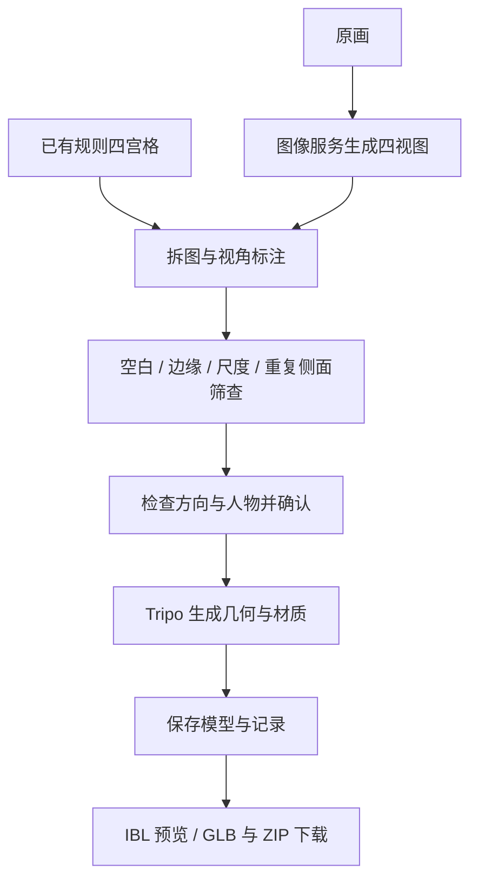

# Tripo Head · 原画 / 四宫格 → 3D 人头

可独立部署的生成与预览应用：上传原画，生成四视图并人工确认，再调用 Tripo 生成带贴图的人头模型；也可以直接上传已有四宫格。浏览器支持 IBL 环境光、模型检查和下载。

**交付状态：v0.5.0 质量关卡与候选管理版，可部署、可演示，等待客户对实际样本的美术效果验收。** 已完成五样本各两次真实生成，新增输入检查、对照验收与可撤销的局部几何微调。新增四视图逐项检查、候选分支、评价证据、盲选、队列与数据管理，使用说明见 [质量管理台](QUALITY_STUDIO.md)。详细范围见 [交付状态与验收](DELIVERY_STATUS.md)、[回归试验](ROBUSTNESS.md)、[微调使用与验证](WORKBENCH.md)。

本项目从 `wangxuanmy/GNM` 的 `apps/tripo_head` 提取并完善。当前生成链路调用图像模型与 Tripo 服务，不执行 Astra/GNM 自动调参；无需安装 GNM、Python、PyTorch 或本地 GPU。[来源与改动](PROVENANCE.md)

## 快速启动

安装并启动 Docker（Windows 使用 Docker Desktop 的 Linux 引擎），在终端执行：

```sh
git clone https://github.com/AnthennyGabriel/tripo_head_2Dg3D.git
cd tripo_head_2Dg3D
docker compose up -d --build
```

打开 **http://127.0.0.1:8771/**。默认使用空白配置，能查看内置真实样例、导入本地 GLB、拆分四宫格；生成新内容需配置自己的凭证。首次构建需要联网，完成后已有模型预览不依赖 CDN。

Windows 也可以在目录内运行 `./start.ps1`；端口冲突时运行 `./start.ps1 -Port 8775`。

## 配置生成服务

1. 复制 `config.example.yaml` 为 `config.local.yaml`，在所用区域填入客户自己的 `api_key` 和服务提供方指定的 `base_url`。
2. 复制 `.env.example` 为 `.env`，按需更改端口。
3. 执行 `docker compose up -d --force-recreate`，在网页选择已配置的区域。

至少配置一个区域即可。密钥只在后端读取，配置文件运行时只读挂载。真实配置、`.env` 和运行任务目录均被 Git 和 Docker 排除；不要将密钥填写进示例配置。[凭证管理](SECURITY.md)

图片生成与 3D 生成使用外部服务，需网络、账户权限及额度。服务模型可用性与收费由提供方决定。仓库不提供共享账户或免费生成额度。

## 操作流程



- **原画入口：**设置是否保留或去除头发、胡须，生成四视图后对照原画检查人物特征。
- **四宫格入口：**上传规则 2×2 图片，指定四个图块的方向；此入口跳过图片生成，不再次修改原画。
- **确认生成：**勾选视图后点击生成。支持左右方向交换；复杂排版请先裁剪成规则四宫格。
- **预览检查：**原材质、白模、无光照贴图、法线、线框；固定视角、正交/透视；IBL 环境、强度与曝光。
- **导出：**模型文件、输入与中间图片、任务记录、完整 ZIP。GLB 可直接预览；若服务返回其他格式，保留原文件下载。
- **本地展示：**内置样例与自带贴图的 GLB 无需服务凭证。Three.js 和 HDR 环境贴图由应用本地提供。

IBL 改变显示光照，不修改下载模型的几何或贴图。白模模式可帮助判断外形是否只靠纹理显得相似。

**质量回归：**打开 `/benchmark.html`，按样本并排查看独立重复结果，填写人工可用性、问题部位、四视图是否需要重做与实际返修时间；可导出 JSON。AI 意见单列，不计入人工通过率。保留原始提示词为默认；人物特征约束 v1 是实验选项，本轮没有证明更可靠。复验命令、费用与判定口径见 [ROBUSTNESS.md](ROBUSTNESS.md)。

## 数据、恢复与升级

任务保存在 Docker 命名卷 `head-jobs` 中（实际名称带 Compose 项目前缀）。普通重启或重建保留数据；`docker compose down -v` 会删除数据卷，交付结果需先备份。

等待视图确认的任务可重启后继续。外部任务 ID 已保存时，可恢复查询并下载原结果。提交中断且未取得 ID 时显示“需核对”，避免自动再次提交产生重复费用。

更新后执行 `docker compose up -d --build`。默认端口只绑定本机，适合单机交付与现场演示；当前版本没有多用户登录、租户隔离或公网部署鉴权。

## 开发与验证

Node.js 24 LTS：

```sh
npm ci
npm test
npm run check:secrets
npm start
```

原生启动默认读取 `config.local.yaml`；也可用 `TRIPO_HEAD_CONFIG` 指定配置路径。`TRIPO_HEAD_JOBS`、`TRIPO_HEAD_PORT` 可更改数据目录与端口。测试使用模拟服务，不消耗生成额度。

`npm run pack:delivery` 导出不含运行配置与数据的源码 ZIP。`npm run check:secrets` 扫描 Git 索引中实际准备交付的内容；新增文件需先 `git add`。

基础镜像默认使用固定摘要的 Docker 官方 Node 镜像 ECR 镜像源。需要切换源时：

```sh
docker compose build --build-arg BASE_IMAGE=node:24-bookworm-slim
docker compose up -d
```

## 来源与素材

保留上游 Apache-2.0 许可证，参见 [LICENSE](LICENSE) 与 [来源说明](PROVENANCE.md)。第三方依赖遵循各自许可证。HDRI 为 Poly Haven Studio Small 09，CC0，详见其[说明](assets/environments/LICENSE.md)。示例原画与生成模型用于本项目演示，不通过代码许可证授予独立素材再分发或商业使用权。
